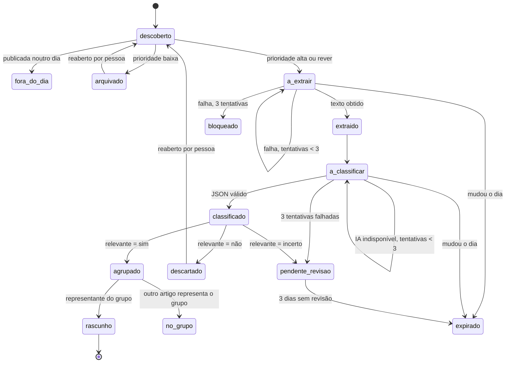

# Especificação técnica — Fases 2 a 4 da recolha

> Estado: **proposta para aprovação, revisão 4** (2026-10-12). Nada aqui está implementado. Cada fase só começa depois de aprovada e fecha com uma entrada no `DECISION_LOG`. A fase 1 (prioridade alta/rever/baixa) está em DEC-063.
>
> Revisão 4: decisões registadas — `source_document` mantém-se (opção B, DEC-064), a política de redirects de §7 está aprovada (DEC-065) e o tratamento de 302/307 fica separado do de 429/503 (DEC-066). Nenhuma decisão implica implementar a fase 2, que continua a precisar da aprovação desta especificação.
>
> Revisão 2, após a revisão do PR #58: redirects só para destinos aprovados por endpoint (§7); 302/307 separados de 429/503 (§5); invariantes da base, transições atómicas e índices (§1.7); estado `expirado` distinto de `fora_do_dia` (§2); opções para `source_document` descritas e decisão exigida antes da migração 0004 (§1.6); normalização de URLs, evidência literal, equidade da fila e retenção concretizadas; testes de aceitação novos (§9).

Regra que atravessa todo o documento: **descobrir não é verificar, verificar não é aprovar, aprovar não é publicar.** Nenhuma fase automatiza a verificação, a aprovação ou a publicação.

## 0. Âmbito e restrições

- Mantém-se Python, SQLite, a CLI `tde`, o GitHub Actions e a revisão humana nas issues. Não entra nenhum serviço novo sempre ligado.
- Tudo gratuito. Uma dependência nova (p. ex. `trafilatura`, um parser HTML) entra por DEC própria, com a razão e a alternativa.
- Rede só pelo transporte de `collectors/http.py` (DEC-033): robots.txt, HTTPS, IP público, limites de tamanho e de tempo. A extracção de texto da fase 3 usa o mesmo transporte.
- Migrações nunca são editadas; cada alteração é uma migração nova (regra de 0001).
- Uma fase de cada vez, para saber que alteração produziu cada efeito.

## 1. Modelo de dados (fase 2, migração `0004_candidate`)

O `raw_item` continua a ser a captura bruta e imutável. O que falta hoje é uma entidade que represente **a notícia** independentemente de quantas vezes e por quantos métodos foi encontrada, com estado de processamento. Proposta:

### 1.1 `candidate` — uma notícia

| Coluna | Tipo | Notas |
| --- | --- | --- |
| `id` | INTEGER PK | |
| `url_key` | TEXT NOT NULL UNIQUE | URL normalizado (secção 4.1); chave de deduplicação |
| `url` | TEXT NOT NULL | URL da primeira descoberta |
| `canonical_url` | TEXT | `<link rel=canonical>` da página, quando a fase 3 a ler |
| `title` | TEXT NOT NULL | título original, sem reescrita |
| `summary` | TEXT | resumo original do feed/sitemap, quando existe |
| `source_id` | TEXT FK `source_registry` | fonte da primeira descoberta |
| `source_tier` | TEXT NOT NULL | |
| `published_at` | TEXT | UTC; nulo se desconhecida (nunca inventada) |
| `published_at_source` | TEXT NOT NULL | `sitemap`, `feed`, `page`, `url`, `first_seen` ou `none` |
| `updated_at_source` | TEXT | data de actualização declarada pela fonte |
| `first_seen_at` / `last_seen_at` | TEXT NOT NULL | datas de recolha (nunca substituem `published_at`) |
| `priority` / `priority_reason` | TEXT NOT NULL | resultado de DEC-063 |
| `state` | TEXT NOT NULL | secção 2 |
| `attempts` | INTEGER NOT NULL | tentativas da etapa em curso |
| `next_attempt_at` | TEXT | quando pode ser retomado |
| `last_error` | TEXT | motivo da última falha |
| `group_id` | INTEGER FK `candidate_group` | acontecimento (secção 4.3) |
| `representative_document_id` | INTEGER FK `source_document` | documento da captura que representa a notícia (DEC-064); nulo até haver um |
| `created_at` / `updated_at` | TEXT NOT NULL | |

### 1.2 `candidate_discovery` — cada vez que um método encontrou a notícia

| Coluna | Tipo | Notas |
| --- | --- | --- |
| `candidate_id` | INTEGER FK | |
| `raw_item_id` | INTEGER FK | a captura bruta correspondente |
| `endpoint_id` | TEXT FK | |
| `method` | TEXT NOT NULL | `rss`, `news_sitemap`, `search`, `html_list`, `json_api`, `open_data` |
| `seen_at` | TEXT NOT NULL | |
| UNIQUE | | (`candidate_id`, `endpoint_id`) |

É esta tabela que permite medir a **cobertura incremental**: notícias que só um método encontrou.

### 1.3 Texto extraído (fase 3) — em `source_document` (DEC-064)

Não há tabela `candidate_text`. A página do artigo descarregada na fase 3 é guardada como uma captura nova (`raw_item` do mesmo endpoint, com o HTML original) e normalizada como `source_document` com `document_kind = page`. O texto, o `text_hash` e o estado da extracção ficam aí; `candidate.representative_document_id` aponta para esse documento. O estado da extracção (`ok`, `empty`, `blocked`, `error`), o extractor e a sua versão entram em `source_document` por migração própria da fase 3. O HTML guardado conta para o tamanho da base e é apagado com o resto por `tde prune` (§6).

### 1.4 `candidate_classification` (fase 3) — saída da IA

`candidate_id`, `provider`, `model`, `prompt_version`, `relevant` (`sim`, `nao`, `incerto`), `topic`, `event_type`, `beneficiaries`, `amounts_and_dates` (JSON), `evidence` (JSON), `official_verification_needed` (0/1), `reason`, `classified_at`. Uma linha por tentativa válida; a mais recente é a que conta.

- `evidence` é uma lista de **excertos literais** do texto extraído, cada um com a posição (`start`, `end`) em `text`. A validação confirma que `text[start:end]` é igual ao excerto; um excerto que não se encontra rejeita a resposta inteira.
- `amounts_and_dates` separa o original do normalizado: cada entrada tem `original` (tal como aparece, p. ex. "537,13 €" ou "31 de outubro"), `normalized` (p. ex. `537.13`, `2026-10-31`) e `evidence_index` (o excerto que o contém). A validação exige que `original` esteja literalmente no excerto; `normalized` é verificado por conversão determinística, não por igualdade de texto.

### 1.5 `candidate_group` e `candidate_transition`

- `candidate_group`: `id`, `label`, `created_at`. Agrupa artigos sobre o mesmo acontecimento, guardando todas as fontes.
- `candidate_transition`: `candidate_id`, `from_state`, `to_state`, `reason`, `run_id`, `at`. Registo de auditoria: responde a "porque é que esta notícia não deu rascunho?".

### 1.6 Ligação ao que já existe

- `whatsapp_draft` passa a poder referir `candidate_id` (coluna nova, nula para os rascunhos antigos). `raw_item_id` mantém-se.
- `tde prune` passa a apagar candidatos por idade (§6), com as suas descobertas, textos, classificações e transições.

**`source_document` — decisão exigida antes de escrever a migração 0004.** Hoje `source_document` (0002) é o documento normalizado de cada `raw_item`, escrito por `tde normalize`; o `daily` não o usa. As duas opções preservam coisas diferentes:

| | A. Absorver em `candidate` + `candidate_text` | B. Manter `source_document` como camada de documento |
| --- | --- | --- |
| Unidade | uma linha por notícia (`candidate`); o texto da página em `candidate_text` | uma linha por captura (`source_document`, por `raw_item`); `candidate` agrupa capturas e aponta para a representante |
| Dados que preserva | texto da página extraída (fase 3); perde-se o documento normalizado por captura | texto normalizado de cada captura, `document_kind`, `duplicate_of`, `text_hash` por captura; o texto da página extraída passa a ser um `source_document` com `document_kind = page` |
| Responsabilidades | `tde normalize` fica obsoleto e é retirado por DEC | `tde normalize` mantém-se e passa a ser chamado pelo `daily`; a extracção da fase 3 escreve em `source_document` |
| Interfaces que mudam | `normalize_command.py`, `SourceDocument` de domínio, testes de 0002 | `daily.py` passa a ler `source_document` em vez de normalizar em memória |
| Risco | perder auditoria por captura | mais uma junção em cada consulta; duas noções de "documento" a explicar |

Em qualquer das opções há uma só fonte de verdade para o texto: em A, `candidate_text`; em B, `source_document`.

**Decidido: opção B (DEC-064, 2026-10-12).** `source_document` mantém o documento de cada captura e a auditoria por captura; `candidate` agrupa as capturas da mesma notícia; `tde normalize` mantém-se e passa a ser chamado pelo `daily`. O resto desta especificação já segue esta opção.

### 1.7 Invariantes da base de dados

A auditoria não pode depender de o código "se lembrar" de manter a base consistente.

- **Valores enumerados:** `priority`, `state`, `published_at_source`, `method`, `relevant` têm `CHECK (coluna IN (...))`. É uma excepção explícita à convenção de 0001/0002 (enumerações só validadas no domínio); `CHECK ... IN` tem equivalente directo em PostgreSQL, por isso respeita DEC-013. A validação no domínio mantém-se.
- **Chaves estrangeiras:** `PRAGMA foreign_keys = ON` já é aplicado em cada ligação (`storage/database.py`). Seguindo DEC-029, não se usa `ON DELETE`: `tde prune` apaga explicitamente por esta ordem, numa transacção: `candidate_transition` → `candidate_classification` → `candidate_discovery` → `whatsapp_draft` ligados → `candidate` → `candidate_group` sem membros → `source_document` das capturas a apagar → `raw_item` sem descobertas (a ordem actual de `prune_raw_items` já apaga `source_document` antes de `raw_item`). Um teste falha se a ordem violar uma chave.
- **Unicidade:** `candidate.url_key` UNIQUE; `candidate_discovery (candidate_id, endpoint_id)` UNIQUE; `source_document.raw_item_id` já é UNIQUE (0002).
- **Índices:** `candidate (state, next_attempt_at)` para a fila; `candidate (published_at)` para a janela do dia; `candidate (group_id)`; `candidate_discovery (endpoint_id, seen_at)` para a cobertura por método; `candidate_transition (candidate_id, at)` para auditoria; `source_document (text_hash)` já existe (0002) e serve §4.2.
- **Transições atómicas:** só uma função de `storage` muda o estado, `transition(conn, candidate_id, expected_state, new_state, reason, run_id)`. Faz `UPDATE candidate SET state = ? ... WHERE id = ? AND state = ?` e, só se uma linha mudou, `INSERT` em `candidate_transition`, tudo na mesma transacção. Se nenhuma linha mudou (outro passo já mexeu no candidato), a transição falha sem efeitos. As transições permitidas estão numa tabela no código (§2); qualquer outra levanta erro antes do SQL.

## 2. Estados e transições

| Estado | Terminal | Quem o resolve |
| --- | --- | --- |
| `fora_do_dia` | sim | já foi descoberta fora do dia de publicação |
| `arquivado` | sim, reabrível | amostra no resumo; `tde candidates reopen ID` |
| `descartado` | sim, reabrível | amostra no resumo, como `arquivado` |
| `bloqueado` | sim, visível | aparece no resumo com o último erro |
| `pendente_revisao` | não | revisão humana (issue com etiqueta `por-classificar`) |
| `expirado` | sim, visível | trabalho que não terminou a tempo; ver abaixo |
| `no_grupo` | sim | a fonte fica guardada no grupo |
| `rascunho` | sim, para este sistema | segue o circuito actual: issue → aprovação → exportação |

Regras:

1. Cada transição é gravada em `candidate_transition`, com o motivo, de forma atómica (§1.7).
2. Nenhuma transição apaga linhas. Só `tde prune` apaga, por idade.
3. Na fase 2 ainda não há extracção nem IA: os candidatos `alta` passam directamente de `descoberto` a `agrupado` e o resto do circuito é o da fase 1. As transições de extracção e classificação entram na fase 3.
4. **Mudança de dia.** No primeiro run depois das 00:00 de Lisboa, os candidatos do dia anterior em `a_extrair` ou `a_classificar` passam a `expirado`. `expirado` é diferente de `fora_do_dia`: quer dizer "havia trabalho por fazer". A transição guarda o estado anterior, as tentativas e o último erro; nenhum destes campos é limpo. O resumo do run mostra quantos expiraram e de que estado vieram, para separar notícias tardias de falhas técnicas.
5. **Revisão humana no dia seguinte.** Um candidato em `pendente_revisao` continua visível depois da meia-noite, com o seu histórico. A regra do próprio dia mantém-se: não gera rascunho depois do seu dia. A revisão serve então para marcar se era relevante, o que alimenta a amostra de referência da fase 3 e a medição de falsos negativos. Ao fim de 3 dias sem decisão (o mesmo prazo das issues, DEC-058), passa a `expirado` com o motivo `sem revisão`.

## 3. Contratos dos collectors

### 3.1 Interface

Mantém-se o protocolo actual (`fetch(endpoint, since) -> Iterable[RawItem]`, DEC-031). Cada collector:

- devolve `RawItem` com `title`, `url`, `published_at_raw` (tal como a fonte a escreve) e `raw_content` com o fragmento original (XML do `<url>` do sitemap, JSON do item, HTML do bloco da lista);
- levanta erro explícito quando a fonte falha (rede, HTTP, formato) e devolve lista vazia só quando a fonte respondeu bem e não tinha itens. **Zero resultados e falha técnica são estados diferentes** e aparecem diferentes no resumo;
- não segue links nem descarrega artigos: descobrir é o seu único papel;
- não acede à rede fora de `HttpsTransport`.

### 3.2 Tipos novos de endpoint

| `endpoint_type` | Fase | Configuração em `sources.yaml` (campo `fetch`) |
| --- | --- | --- |
| `news_sitemap` | 2 | nenhuma: lê `<url>`, `<news:publication_date>`, `<news:title>`; aceita índice de sitemaps com profundidade 1 |
| `json_api` | 4 | `items_path`, `title_field`, `url_field`, `date_field`, `date_format` |
| `html_list` | 4 | `item_selector`, `title_selector`, `link_selector`, `date_selector`, `date_format` |
| `open_data` | 4 | por fonte (p. ex. iniciativas do Parlamento): formato, campos e filtro de data |

`search` (Bing) continua tecnicamente `rss`, mas ganha `method: search` em `candidate_discovery` para as métricas.

### 3.3 Saúde de cada endpoint

- `expect_min_items` opcional por endpoint: abaixo disso durante 2 runs seguidos, o resumo marca a fonte como **suspeita** (canário).
- Para `html_list` e `json_api`, cada endpoint tem um teste com uma cópia real da página guardada em `tests/fixtures/`. Uma alteração de estrutura parte o teste antes de partir a produção.
- O resumo do run passa a ter, por endpoint: itens, novos, só encontrados por ele, falhas, e estado (`ok`, `vazio`, `suspeito`, `falha`).

## 4. Deduplicação

### 4.1 Mesmo artigo

`url_key` é calculado por regras fixas, cada uma com teste:

| Caso | Regra | Exemplo |
| --- | --- | --- |
| Esquema e anfitrião | minúsculas; só `https` (DEC-033) | `HTTPS://WWW.JN.pt/a` → `https://www.jn.pt/a` |
| Porta predefinida | `:443` removida; outra porta mantém-se | `https://eco.sapo.pt:443/x` → `https://eco.sapo.pt/x` |
| Fragmento | removido | `…/a#comentarios` → `…/a` |
| Rastreio | removidos `utm_*`, `fbclid`, `gclid`, `ocid`, `mc_cid`, `mc_eid` | |
| Restantes parâmetros | mantidos e ordenados por nome | `?b=2&a=1` → `?a=1&b=2` |
| Barra final | removida, excepto na raiz | `…/artigo/` → `…/artigo` |
| AMP | `/amp/` final, `?amp`, `?outputType=amp` removidos; `amp.` no anfitrião só se o editor o tiver em `domains` | |
| Anfitriões equivalentes | `www.` e sem `www.` só se juntam quando ambos estão em `domains` da mesma fonte no `sources.yaml`; não há equivalências adivinhadas | |
| Codificação | percent-encoding normalizado para maiúsculas; caracteres não reservados descodificados | `%c3%a7` → `%C3%A7` |

Uma segunda descoberta do mesmo `url_key` acrescenta uma linha em `candidate_discovery` e actualiza `last_seen_at`; não cria candidato novo.

### 4.2 Mesmo texto

Na fase 3, `source_document.text_hash` igual em URLs diferentes (p. ex. a mesma peça da Lusa em vários jornais) junta os candidatos no mesmo grupo e marca os restantes como `no_grupo`.

### 4.3 Mesmo acontecimento

- Fase 2: `same_topic` actual (DEC-059) entre candidatos dos últimos 3 dias cria ou reutiliza um `candidate_group`.
- Fase 3: a IA devolve também uma frase curta do acontecimento; o agrupamento passa a usar título + essa frase.
- Vários jornais com a mesma notícia contam como **um** acontecimento e **não** como confirmação. O representante do grupo é a fonte de nível mais alto (T1 > T2 > T3), depois a mais antiga.
- Testes com pares reais guardados em `tests/fixtures/grouping/`: títulos diferentes sobre o mesmo acontecimento que **devem** juntar-se (p. ex. "PSU entra em vigor" / "Prestação Social Única chega a 31 de dezembro") e acontecimentos parecidos que **não** devem (p. ex. o calendário de pagamentos de outubro e o de novembro; o aumento das pensões e o aumento do salário mínimo).

## 5. Tentativas e recuperação de falhas

Um redirect não é uma falha transitória: é uma instrução. Por isso a fase 2 separa os dois casos e revê o comportamento actual de DEC-062, que repete 302/307 como se fossem temporários. **Decidido: separar (DEC-066, 2026-10-12).** A decisão muda a política de execução, mas não activa redirects em nenhum endpoint: isso só acontece depois de a implementação passar os testes de segurança de §9.

| Resposta ou falha | Comportamento |
| --- | --- |
| 302, 307 (e 301, 308) | se o endpoint tiver destinos aprovados (§7) e o `Location` for um deles, segue um único salto, com as verificações de §7; senão, regista "redirect recusado: <destino>" e não repete o pedido |
| 302/307 que são limitação conhecida | excepção documentada, não regra global: só para endpoints marcados `redirect_is_throttle: true` (hoje, as pesquisas do Bing, onde o 307 observado em 2026-10-11 era limitação): uma nova tentativa, e o resumo conta-a como limitação, não como redirect |
| 429, 503 | nova tentativa; espera o `Retry-After` se vier (segundos ou data HTTP), com um máximo de 60 s; sem cabeçalho, ou com um valor inválido, 20 s; no máximo uma nova tentativa por run |
| Endpoint em erro | regista `last_error`; os outros endpoints continuam (já é assim); 2 runs seguidos em erro → aviso no resumo |
| Extracção falhada | `attempts + 1`, `next_attempt_at` = run seguinte; 3 falhas → `bloqueado` |
| IA sem resposta, quota esgotada ou JSON inválido | tenta o fornecedor seguinte da cadeia; se todos falharem, `attempts + 1`; 3 falhas → `pendente_revisao` |
| Run interrompido | o run seguinte retoma os candidatos não terminais; cada passo é idempotente e cada transição é atómica (§1.7) |

**Limites por run e equidade da fila.** Até 60 extracções e até 60 classificações por run (configuráveis). A fila não é só por prioridade, para os `rever` não ficarem para sempre atrás dos `alta`: dois terços dos lugares vão para `alta` e um terço para `rever`; lugares não usados por uma passam para a outra. Dentro de cada prioridade, primeiro os mais antigos (`first_seen_at`). O excedente fica na fila com o motivo `limite do run`, e o resumo mostra a idade do item mais antigo em espera.

## 6. Limites temporais

- **Regra editorial (mantém-se):** só gera rascunho o que foi publicado no próprio dia, em Lisboa.
- **Data de publicação, por precedência:** `news:publication_date` → `pubDate`/`updated` do feed → `datePublished` da página (JSON-LD, fase 3) → data no URL → primeira recolha (só se o endpoint já tinha sido recolhido antes, DEC-061) → nenhuma. A origem fica em `published_at_source`.
- **Janela técnica:** com a regra do próprio dia, guardar candidatos serve deduplicação, agrupamento e auditoria; não recupera notícias para publicar. A recuperação de falhas faz-se dentro do dia, pelos três runs e pela fila de pendentes.
- **Retenção (`tde prune`):** N = 60 dias, o valor já usado no workflow. Contam a partir de `last_seen_at`, e um candidato com rascunho ainda `pending` ou `approved` não é apagado. Apaga-se o candidato com as suas descobertas, textos, classificações e transições, pela ordem de §1.7. O que fica para auditoria de longo prazo é o agregado por run (contagens por estado, método, prioridade e fonte) em `run.stats`, que `prune` não apaga.
- **Questão para decidir:** um quarto run ao fim da noite (p. ex. 22:37 UTC) reduz as notícias do fim do dia que nunca entram. Custo: mais minutos de Actions e mais pedidos aos editores.

## 7. Política de redirects

Hoje nenhum redirect é seguido (DEC-033), e vários endpoints ficaram inactivos por isso. **Política aprovada (DEC-065, 2026-10-12), por implementar na fase 2.** Condição da aprovação: a implementação valida o anfitrião e o destino final de forma a impedir redirects para endereços internos ou não autorizados; os testes de segurança de §9 são obrigatórios antes de activar qualquer `redirect_hosts`.

- **Só destinos aprovados, por endpoint.** Em `sources.yaml`, um endpoint pode ter `redirect_hosts: [jn.pt]`, a lista **exacta** de anfitriões para onde se aceita ir. Sem a lista, nenhum redirect é seguido. Não há cálculo de "domínio registável": comparar os dois últimos rótulos ou manter uma lista de sufixos à mão dá decisões erradas. Se algum dia for preciso aceitar destinos de forma genérica, usa-se uma implementação da Public Suffix List, por DEC própria.
- **No máximo um salto**, e só HTTPS → HTTPS. Um segundo redirect é recusado.
- **O destino é revalidado como um pedido novo**, antes de ser contactado: anfitrião na lista, resolução DNS para IP público (`_is_public`, que já recusa endereços loopback, privados, link-local, multicast, reservados e não especificados), robots.txt do destino, limites de tamanho, tempo e intervalo por anfitrião.
- O URL original e o final ficam registados na descoberta. Um redirect recusado aparece como falha, com o destino e o motivo.
- A aprovação de cada `redirect_hosts` segue o protocolo de validação de fontes (`docs/source_validation/<id>.md`): é uma pessoa que confirma o destino.

## 8. Persistência — opções a comparar (sem decisão)

A fase 2 torna a base mais valiosa: perder a base passa a significar perder estados, tentativas e o histórico de auditoria. A decisão fica para a abertura da fase 2, com dados reais. Opções:

| Opção | Perda | Concorrência | Segurança | Manutenção | Limites conhecidos |
| --- | --- | --- | --- | --- | --- |
| A. Cache do Actions (actual, DEC-061) | possível: o GitHub remove entradas sem acesso há 7 dias e quando o repositório passa o limite de cache; um run falhado antes de guardar perde esse run | o grupo `daily-pipeline` já serializa os runs; caches de outros branches não são lidos pelo `main` | privado ao repositório | nenhuma | 10 GB por repositório |
| B. Branch próprio (`data`) com o ficheiro SQLite | baixa: fica no histórico Git | dois runs a fazer push em simultâneo dão conflito; mitigado pelo grupo de concorrência e por `push` com nova tentativa | o ficheiro fica no repositório (privado); quem tem acesso de leitura vê os dados | histórico cresce a cada commit binário; exige limpeza periódica (branch órfão reescrito) | ficheiros acima de 100 MB são recusados pelo GitHub |
| C. Artefacto do workflow | média: os artefactos expiram no prazo de retenção configurado | o run seguinte tem de procurar o artefacto mais recente pela API | privado ao repositório | código para descarregar o último artefacto | quota de armazenamento do plano (a confirmar para este repositório) |
| D. Híbrido: A no dia-a-dia + cópia diária em C ou B | baixa | como A | como B ou C | mais um passo no workflow | soma dos limites |

Os dados guardados são notícias públicas, rascunhos e metadados; não há dados pessoais. Mesmo assim, a escolha entre B e C tem de ter em conta quem tem acesso ao repositório.

**Como decidir:** na primeira semana da fase 2, medir o tamanho da base por dia e definir quanto se pode perder (um run? um dia?). Com esses dois números, a tabela acima dá a resposta.

## 9. Fases, entregáveis e critérios de conclusão

### Fase 2 — Registo persistente e descoberta redundante

Entregáveis: migração `0004`; `candidate`, `candidate_discovery`, `candidate_group`, `candidate_transition`; collector `news_sitemap`; Executive Digest, Notícias ao Minuto e JN validados, depois os restantes editores, um a um; resumo por método.

Testes de aceitação:
- O mesmo artigo encontrado por RSS e por sitemap gera **um** candidato e **duas** descobertas.
- Dois runs seguidos com as mesmas fontes não criam candidatos novos (idempotência).
- Um endpoint vazio e um endpoint em erro aparecem com estados diferentes no resumo.
- Nenhum candidato muda de estado sem linha em `candidate_transition`.
- A migração aplica-se sobre uma cópia da base actual sem perder `raw_item` nem `whatsapp_draft`.
- Um valor fora dos enumerados é recusado pela base (`CHECK`), mesmo escrito por SQL directo.
- Uma transição com `expected_state` errado não muda nada e não grava `candidate_transition`; duas transições concorrentes sobre o mesmo candidato resultam numa só.
- `tde prune` sobre uma base com candidatos de todos os estados não viola nenhuma chave estrangeira e não apaga candidatos com rascunho pendente ou aprovado.
- **Recuperação após interrupção:** um run interrompido a meio (simulado por excepção depois de N candidatos) é retomado pelo run seguinte sem duplicar candidatos, descobertas nem transições.
- **Redirects (segurança):** com transporte falso, cada caso tem teste — destino fora de `redirect_hosts` recusado; segundo salto recusado; HTTPS → HTTP recusado; destino que resolve para 127.0.0.1, 10.0.0.0/8 ou ::1 recusado; destino com robots.txt a proibir recusado; 307 em endpoint `redirect_is_throttle` repetido uma vez e contado como limitação.
- **429/503:** `Retry-After` em segundos e em data HTTP respeitado até 60 s; sem cabeçalho ou com valor inválido, 20 s; uma só nova tentativa.
- **Separação (DEC-066):** um 302/307 em endpoint sem `redirect_hosts` e sem `redirect_is_throttle` não é repetido; o mesmo código num endpoint `redirect_is_throttle` é repetido uma vez; um 429/503 nunca é tratado como redirect.
- **Sitemaps:** índice de sitemaps (profundidade 1), namespaces `sitemap/0.9` e `news/0.9` com prefixos diferentes, entrada sem `news:publication_date` (fica `published_at_source = none`), data mal formada, XML truncado (erro, não vazio), sitemap válido sem entradas (vazio, não erro), ficheiro acima do limite de tamanho (erro).
- **URL:** cada linha da tabela de §4.1 tem um teste.
- **Fila:** com 100 `alta` e 10 `rever` e limite 60, entram pelo menos 10 `rever`.
- **Mudança de dia:** um candidato em `a_classificar` com 2 tentativas e erro passa a `expirado` guardando estado anterior, tentativas e erro.

Critério de conclusão: o resumo mostra, por método, quantas notícias novas cada um acrescenta e quantas duplica, em pelo menos 3 dias de runs reais.

### Fase 3 — Extracção e classificação

Entregáveis: `candidate_classification`; estado da extracção em `source_document` (DEC-064); extracção com trafilatura; classificação JSON com validação por esquema; fila `pendente_revisao`; rascunhos redigidos a partir dos campos extraídos.

Antes de escrever código:
- **Conjunto de extracção:** 30 a 50 páginas reais de sites portugueses (incluindo sites com bloqueio, JavaScript e datas mal formatadas), guardadas em `tests/fixtures/`. Mede-se texto útil, data e título por site. Onde o trafilatura falhar, avaliam-se parsers do Fundus ou regras próprias.
- **Amostra de referência:** 100 a 150 candidatos de 5 dias de runs, marcados por ti como relevante/não relevante. É esta amostra que mede precisão e falsos negativos.

Testes de aceitação:
- A saída da IA que não cumpre o esquema é rejeitada e o candidato fica pendente.
- Cada excerto de `evidence` corresponde exactamente a `text[start:end]`; um excerto inexistente rejeita a resposta.
- Cada `original` de `amounts_and_dates` está literalmente no seu excerto; cada `normalized` resulta do `original` pela conversão determinística (p. ex. "537,13 €" → 537.13; "31 de outubro" → 2026-10-31).
- Com a IA desligada, nenhum candidato se perde: fica em `a_classificar` ou `pendente_revisao`.

Critério de conclusão: precisão e falsos negativos medidos contra a amostra de referência e registados na DEC da fase. A escolha entre Gemini e Groq faz-se por esse teste, não por suposição.

### Fase 4 — Fontes oficiais

Ordem proposta: Parlamento (dados abertos, `open_data`), DRE com filtro por emissor e matéria, Segurança Social, IEFP, Governo, Finanças, DGES, habitação. Uma fonte de cada vez.

Para cada fonte, antes de activar:
- descobrir o mecanismo real de carregamento (pedido JSON por trás da página, dados abertos, HTML do servidor) e preferir o mais estruturado;
- teste com cópia real em `tests/fixtures/`;
- `expect_min_items` e canário;
- registo em `docs/source_validation/<id>.md`.

Critério de conclusão por fonte: teste funcional a passar, estado de saúde no resumo e 5 dias de runs reais sem falsos "vazio". Uma iniciativa do Parlamento entra como **proposta**, nunca como medida em vigor; um diploma do DRE é a fonte de confirmação, não de descoberta jornalística.

## 10. Questões em aberto

Decididas em 2026-10-12:

- `source_document`: opção B (DEC-064).
- Política de redirects de §7: aprovada, com a condição de §7 (DEC-065).

- Tratamento de 302/307 de DEC-062 (§5): separado do de 429/503, com a excepção do Bing documentada (DEC-066).

Já não há decisões de arquitectura a bloquear a fase 2; falta a aprovação desta especificação.

Decidem-se com dados, durante as fases:

1. Persistência (§8): na primeira semana da fase 2, com o tamanho medido da base e a perda aceitável.
2. Quarto run ao fim da noite (§6): pelas notícias tardias e expiradas observadas em vários dias.
3. Parser HTML para `html_list`: comparar alternativas com páginas reais antes de acrescentar a dependência.
4. Amostra de referência da fase 3: quem marca, como, e com que frequência se repete; definida antes de comparar Gemini e Groq.
