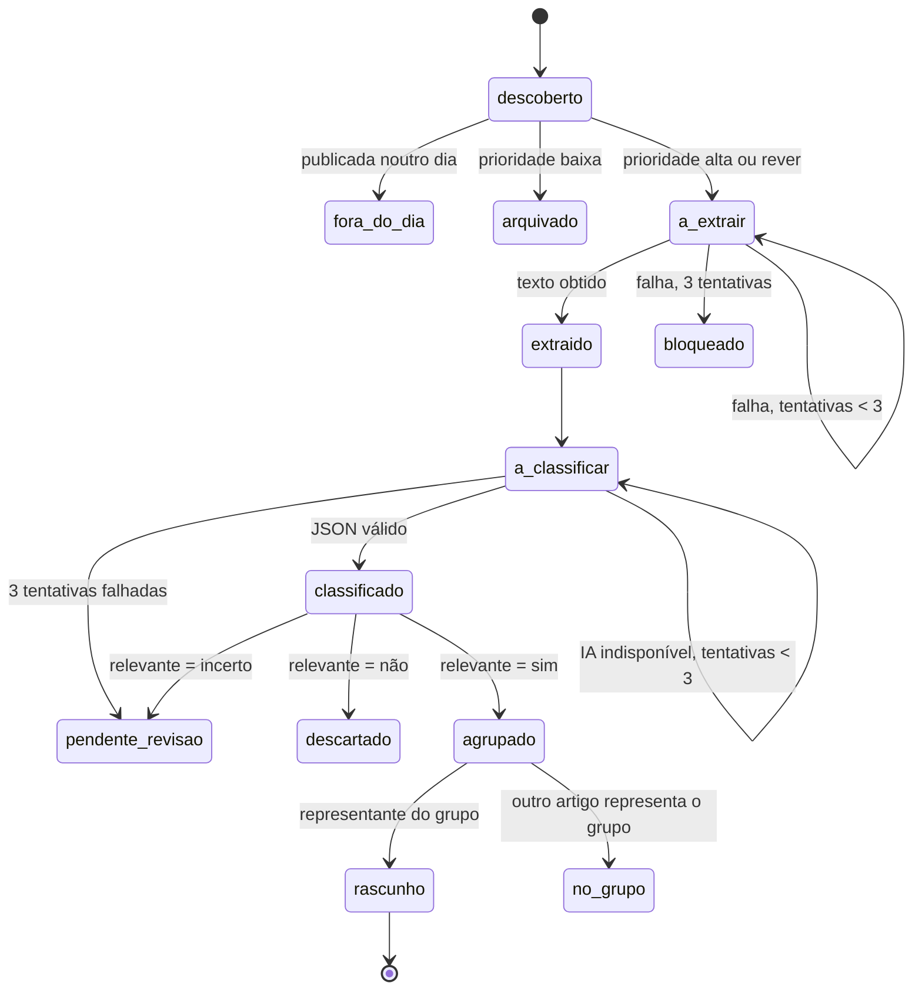

# Especificação técnica — Fases 2 a 4 da recolha

> Estado: **proposta para aprovação** (2026-10-12). Nada aqui está implementado. Cada fase só começa depois de aprovada e fecha com uma entrada no `DECISION_LOG`. A fase 1 (prioridade alta/rever/baixa) está em DEC-063.

Regra que atravessa todo o documento: **descobrir não é verificar, verificar não é aprovar, aprovar não é publicar.** Nenhuma fase automatiza a verificação, a aprovação ou a publicação.

## 0. Âmbito e restrições

- Mantém-se Python, SQLite, a CLI `tde`, o GitHub Actions e a revisão humana nas issues. Não entra nenhum serviço novo sempre ligado.
- Tudo gratuito. Uma dependência nova (p. ex. `trafilatura`, um parser HTML) entra por DEC própria, com a razão e a alternativa.
- Rede só pelo transporte de `collectors/http.py` (DEC-033): robots.txt, HTTPS, IP público, limites de tamanho e de tempo. A extracção de texto da fase 3 usa o mesmo transporte.
- Migrações nunca são editadas; cada alteração é uma migração nova (regra de 0001).
- Uma fase de cada vez, para saber que alteração produziu cada efeito.

## 1. Modelo de dados (fase 2, migração `0004_candidate`)

O `raw_item` continua a ser a captura bruta e imutável. O que falta hoje é uma entidade que represente **a notícia** independentemente de quantas vezes e por quantos métodos foi encontrada, com estado de processamento. Proposta:

### 1.1 `candidate` — uma notícia

| Coluna | Tipo | Notas |
| --- | --- | --- |
| `id` | INTEGER PK | |
| `url_key` | TEXT NOT NULL UNIQUE | URL normalizado (secção 4.1); chave de deduplicação |
| `url` | TEXT NOT NULL | URL da primeira descoberta |
| `canonical_url` | TEXT | `<link rel=canonical>` da página, quando a fase 3 a ler |
| `title` | TEXT NOT NULL | título original, sem reescrita |
| `summary` | TEXT | resumo original do feed/sitemap, quando existe |
| `source_id` | TEXT FK `source_registry` | fonte da primeira descoberta |
| `source_tier` | TEXT NOT NULL | |
| `published_at` | TEXT | UTC; nulo se desconhecida (nunca inventada) |
| `published_at_source` | TEXT NOT NULL | `sitemap`, `feed`, `page`, `url`, `first_seen` ou `none` |
| `updated_at_source` | TEXT | data de actualização declarada pela fonte |
| `first_seen_at` / `last_seen_at` | TEXT NOT NULL | datas de recolha (nunca substituem `published_at`) |
| `priority` / `priority_reason` | TEXT NOT NULL | resultado de DEC-063 |
| `state` | TEXT NOT NULL | secção 2 |
| `attempts` | INTEGER NOT NULL | tentativas da etapa em curso |
| `next_attempt_at` | TEXT | quando pode ser retomado |
| `last_error` | TEXT | motivo da última falha |
| `group_id` | INTEGER FK `candidate_group` | acontecimento (secção 4.3) |
| `created_at` / `updated_at` | TEXT NOT NULL | |

### 1.2 `candidate_discovery` — cada vez que um método encontrou a notícia

| Coluna | Tipo | Notas |
| --- | --- | --- |
| `candidate_id` | INTEGER FK | |
| `raw_item_id` | INTEGER FK | a captura bruta correspondente |
| `endpoint_id` | TEXT FK | |
| `method` | TEXT NOT NULL | `rss`, `news_sitemap`, `search`, `html_list`, `json_api`, `open_data` |
| `seen_at` | TEXT NOT NULL | |
| UNIQUE | | (`candidate_id`, `endpoint_id`) |

É esta tabela que permite medir a **cobertura incremental**: notícias que só um método encontrou.

### 1.3 `candidate_text` (fase 3) — texto extraído

`candidate_id` (PK/FK), `extractor` (`trafilatura` + versão), `status` (`ok`, `empty`, `blocked`, `error`), `http_status`, `text`, `text_hash`, `extracted_at`. Fica numa tabela própria para a `candidate` não crescer com texto.

### 1.4 `candidate_classification` (fase 3) — saída da IA

`candidate_id`, `provider`, `model`, `prompt_version`, `relevant` (`sim`, `nao`, `incerto`), `topic`, `event_type`, `beneficiaries`, `amounts_and_dates` (JSON), `evidence` (JSON com excertos literais), `official_verification_needed` (0/1), `reason`, `classified_at`. Uma linha por tentativa válida; a mais recente é a que conta.

### 1.5 `candidate_group` e `candidate_transition`

- `candidate_group`: `id`, `label`, `created_at`. Agrupa artigos sobre o mesmo acontecimento, guardando todas as fontes.
- `candidate_transition`: `candidate_id`, `from_state`, `to_state`, `reason`, `run_id`, `at`. Registo de auditoria: responde a "porque é que esta notícia não deu rascunho?".

### 1.6 Ligação ao que já existe

- `whatsapp_draft` passa a poder referir `candidate_id` (coluna nova, nula para os rascunhos antigos). `raw_item_id` mantém-se.
- `source_document` (0002) não é usado pelo `daily`. A fase 2 decide se é absorvido por `candidate`/`candidate_text` ou se fica para o `tde normalize`; não se mantêm duas fontes de verdade.
- `tde prune` passa a apagar candidatos terminados há mais de N dias, com as suas descobertas, textos e transições.

## 2. Estados e transições

| Estado | Terminal | Quem o resolve |
| --- | --- | --- |
| `fora_do_dia` | sim | regra editorial do próprio dia |
| `arquivado` | sim, auditável | amostra no resumo; a pessoa pode reabrir com `tde candidates reopen ID` |
| `bloqueado` | sim, visível | aparece no resumo com o último erro |
| `descartado` | sim, auditável | amostra no resumo, como `arquivado` |
| `pendente_revisao` | não | revisão humana (issue com etiqueta `por-classificar`) |
| `no_grupo` | sim | a fonte fica guardada no grupo |
| `rascunho` | sim, para este sistema | segue o circuito actual: issue → aprovação → exportação |

Regras:

1. Cada transição é gravada em `candidate_transition`, com o motivo.
2. Nenhuma transição apaga linhas. Só `tde prune` apaga, por idade.
3. Na fase 2 ainda não há extracção nem IA: os candidatos `alta` passam directamente de `descoberto` a `agrupado` e o resto do circuito é o da fase 1. As transições de extracção e classificação entram na fase 3.
4. Às 00:00 de Lisboa, os candidatos do dia anterior ainda em `a_extrair` ou `a_classificar` passam a `fora_do_dia` com o motivo `expirou antes de concluir`, e o resumo do primeiro run do dia conta-os.

## 3. Contratos dos collectors

### 3.1 Interface

Mantém-se o protocolo actual (`fetch(endpoint, since) -> Iterable[RawItem]`, DEC-031). Cada collector:

- devolve `RawItem` com `title`, `url`, `published_at_raw` (tal como a fonte a escreve) e `raw_content` com o fragmento original (XML do `<url>` do sitemap, JSON do item, HTML do bloco da lista);
- levanta erro explícito quando a fonte falha (rede, HTTP, formato) e devolve lista vazia só quando a fonte respondeu bem e não tinha itens. **Zero resultados e falha técnica são estados diferentes** e aparecem diferentes no resumo;
- não segue links nem descarrega artigos: descobrir é o seu único papel;
- não acede à rede fora de `HttpsTransport`.

### 3.2 Tipos novos de endpoint

| `endpoint_type` | Fase | Configuração em `sources.yaml` (campo `fetch`) |
| --- | --- | --- |
| `news_sitemap` | 2 | nenhuma: lê `<url>`, `<news:publication_date>`, `<news:title>`; aceita índice de sitemaps com profundidade 1 |
| `json_api` | 4 | `items_path`, `title_field`, `url_field`, `date_field`, `date_format` |
| `html_list` | 4 | `item_selector`, `title_selector`, `link_selector`, `date_selector`, `date_format` |
| `open_data` | 4 | por fonte (p. ex. iniciativas do Parlamento): formato, campos e filtro de data |

`search` (Bing) continua tecnicamente `rss`, mas ganha `method: search` em `candidate_discovery` para as métricas.

### 3.3 Saúde de cada endpoint

- `expect_min_items` opcional por endpoint: abaixo disso durante 2 runs seguidos, o resumo marca a fonte como **suspeita** (canário).
- Para `html_list` e `json_api`, cada endpoint tem um teste com uma cópia real da página guardada em `tests/fixtures/`. Uma alteração de estrutura parte o teste antes de partir a produção.
- O resumo do run passa a ter, por endpoint: itens, novos, só encontrados por ele, falhas, e estado (`ok`, `vazio`, `suspeito`, `falha`).

## 4. Deduplicação

### 4.1 Mesmo artigo

`url_key` = URL com o esquema e o anfitrião em minúsculas, sem fragmento, sem parâmetros de rastreio (`utm_*`, `fbclid`, `gclid`, `ocid`), sem barra final e sem variantes AMP conhecidas (`/amp/`, `?amp`). Uma segunda descoberta do mesmo `url_key` acrescenta uma linha em `candidate_discovery` e actualiza `last_seen_at`; não cria candidato novo.

### 4.2 Mesmo texto

Na fase 3, `candidate_text.text_hash` igual em URLs diferentes (p. ex. a mesma peça da Lusa em vários jornais) junta os candidatos no mesmo grupo e marca os restantes como `no_grupo`.

### 4.3 Mesmo acontecimento

- Fase 2: `same_topic` actual (DEC-059) entre candidatos dos últimos 3 dias cria ou reutiliza um `candidate_group`.
- Fase 3: a IA devolve também uma frase curta do acontecimento; o agrupamento passa a usar título + essa frase.
- Vários jornais com a mesma notícia contam como **um** acontecimento e **não** como confirmação. O representante do grupo é a fonte de nível mais alto (T1 > T2 > T3), depois a mais antiga.

## 5. Tentativas e recuperação de falhas

| Falha | Comportamento |
| --- | --- |
| Endpoint em erro | regista `last_error`; os outros endpoints continuam (já é assim); 2 runs seguidos em erro → aviso no resumo |
| HTTP 302/307/429/503 | uma nova tentativa após 20 s (DEC-062) |
| Extracção falhada | `attempts + 1`, `next_attempt_at` = run seguinte; 3 falhas → `bloqueado` |
| IA sem resposta, quota esgotada ou JSON inválido | tenta o fornecedor seguinte da cadeia; se todos falharem, `attempts + 1`; 3 falhas → `pendente_revisao` |
| Run interrompido | o run seguinte retoma os candidatos não terminais; cada passo é idempotente |

Limites por run: até 60 extracções e até 60 classificações (configuráveis), por ordem de prioridade e de data. O excedente fica em fila com o motivo `limite do run`.

## 6. Limites temporais

- **Regra editorial (mantém-se):** só gera rascunho o que foi publicado no próprio dia, em Lisboa.
- **Data de publicação, por precedência:** `news:publication_date` → `pubDate`/`updated` do feed → `datePublished` da página (JSON-LD, fase 3) → data no URL → primeira recolha (só se o endpoint já tinha sido recolhido antes, DEC-061) → nenhuma. A origem fica em `published_at_source`.
- **Janela técnica:** os candidatos ficam guardados 60 dias (`tde prune`). Com a regra do próprio dia, esta janela serve deduplicação, agrupamento e auditoria; não recupera notícias para publicar. A recuperação de falhas faz-se dentro do dia, pelos três runs e pela fila de pendentes.
- **Questão para decidir:** um quarto run ao fim da noite (p. ex. 22:37 UTC) reduz as notícias do fim do dia que nunca entram. Custo: mais minutos de Actions e mais pedidos aos editores.

## 7. Política de redirects

Hoje nenhum redirect é seguido (DEC-033), e vários endpoints ficaram inactivos por isso. Proposta, a aprovar:

- Por endpoint, `follow_redirect: same_site` (predefinição: desligado).
- No máximo **um** salto.
- Só HTTPS → HTTPS.
- O destino tem de estar no mesmo domínio registável (p. ex. `www.jn.pt` → `jn.pt`). Para não acrescentar dependências, a regra compara os dois últimos rótulos do anfitrião, com uma lista explícita de sufixos de dois níveis usados pelas fontes (`gov.pt`, `com.pt`, `org.pt`).
- O destino passa pelas mesmas verificações do pedido original: resolução para IP público (`_is_public`), robots.txt do destino, limites de tamanho e tempo.
- O URL original e o final ficam registados. Um redirect recusado continua a aparecer como falha, com o motivo.

## 8. Persistência — opções a comparar (sem decisão)

A fase 2 torna a base mais valiosa: perder a base passa a significar perder estados, tentativas e o histórico de auditoria. A decisão fica para a abertura da fase 2, com dados reais. Opções:

| Opção | Perda | Concorrência | Segurança | Manutenção | Limites conhecidos |
| --- | --- | --- | --- | --- | --- |
| A. Cache do Actions (actual, DEC-061) | possível: o GitHub remove entradas sem acesso há 7 dias e quando o repositório passa o limite de cache; um run falhado antes de guardar perde esse run | o grupo `daily-pipeline` já serializa os runs; caches de outros branches não são lidos pelo `main` | privado ao repositório | nenhuma | 10 GB por repositório |
| B. Branch próprio (`data`) com o ficheiro SQLite | baixa: fica no histórico Git | dois runs a fazer push em simultâneo dão conflito; mitigado pelo grupo de concorrência e por `push` com nova tentativa | o ficheiro fica no repositório (privado); quem tem acesso de leitura vê os dados | histórico cresce a cada commit binário; exige limpeza periódica (branch órfão reescrito) | ficheiros acima de 100 MB são recusados pelo GitHub |
| C. Artefacto do workflow | média: os artefactos expiram no prazo de retenção configurado | o run seguinte tem de procurar o artefacto mais recente pela API | privado ao repositório | código para descarregar o último artefacto | quota de armazenamento do plano (a confirmar para este repositório) |
| D. Híbrido: A no dia-a-dia + cópia diária em C ou B | baixa | como A | como B ou C | mais um passo no workflow | soma dos limites |

Os dados guardados são notícias públicas, rascunhos e metadados; não há dados pessoais. Mesmo assim, a escolha entre B e C tem de ter em conta quem tem acesso ao repositório.

**Como decidir:** na primeira semana da fase 2, medir o tamanho da base por dia e definir quanto se pode perder (um run? um dia?). Com esses dois números, a tabela acima dá a resposta.

## 9. Fases, entregáveis e critérios de conclusão

### Fase 2 — Registo persistente e descoberta redundante

Entregáveis: migração `0004`; `candidate`, `candidate_discovery`, `candidate_group`, `candidate_transition`; collector `news_sitemap`; Executive Digest, Notícias ao Minuto e JN validados, depois os restantes editores, um a um; resumo por método.

Testes de aceitação:
- O mesmo artigo encontrado por RSS e por sitemap gera **um** candidato e **duas** descobertas.
- Dois runs seguidos com as mesmas fontes não criam candidatos novos (idempotência).
- Um endpoint vazio e um endpoint em erro aparecem com estados diferentes no resumo.
- Nenhum candidato muda de estado sem linha em `candidate_transition`.
- A migração aplica-se sobre uma cópia da base actual sem perder `raw_item` nem `whatsapp_draft`.

Critério de conclusão: o resumo mostra, por método, quantas notícias novas cada um acrescenta e quantas duplica, em pelo menos 3 dias de runs reais.

### Fase 3 — Extracção e classificação

Entregáveis: `candidate_text` e `candidate_classification`; extracção com trafilatura; classificação JSON com validação por esquema; fila `pendente_revisao`; rascunhos redigidos a partir dos campos extraídos.

Antes de escrever código:
- **Conjunto de extracção:** 30 a 50 páginas reais de sites portugueses (incluindo sites com bloqueio, JavaScript e datas mal formatadas), guardadas em `tests/fixtures/`. Mede-se texto útil, data e título por site. Onde o trafilatura falhar, avaliam-se parsers do Fundus ou regras próprias.
- **Amostra de referência:** 100 a 150 candidatos de 5 dias de runs, marcados por ti como relevante/não relevante. É esta amostra que mede precisão e falsos negativos.

Testes de aceitação:
- A saída da IA que não cumpre o esquema é rejeitada e o candidato fica pendente.
- Todo o número ou data em `amounts_and_dates` aparece literalmente em `evidence` e no texto extraído.
- Com a IA desligada, nenhum candidato se perde: fica em `a_classificar` ou `pendente_revisao`.

Critério de conclusão: precisão e falsos negativos medidos contra a amostra de referência e registados na DEC da fase. A escolha entre Gemini e Groq faz-se por esse teste, não por suposição.

### Fase 4 — Fontes oficiais

Ordem proposta: Parlamento (dados abertos, `open_data`), DRE com filtro por emissor e matéria, Segurança Social, IEFP, Governo, Finanças, DGES, habitação. Uma fonte de cada vez.

Para cada fonte, antes de activar:
- descobrir o mecanismo real de carregamento (pedido JSON por trás da página, dados abertos, HTML do servidor) e preferir o mais estruturado;
- teste com cópia real em `tests/fixtures/`;
- `expect_min_items` e canário;
- registo em `docs/source_validation/<id>.md`.

Critério de conclusão por fonte: teste funcional a passar, estado de saúde no resumo e 5 dias de runs reais sem falsos "vazio". Uma iniciativa do Parlamento entra como **proposta**, nunca como medida em vigor; um diploma do DRE é a fonte de confirmação, não de descoberta jornalística.

## 10. Questões em aberto

1. Política de redirects (secção 7): aprovar ou manter DEC-033.
2. Persistência (secção 8): decidir na abertura da fase 2, com o tamanho medido da base.
3. Quarto run ao fim da noite (secção 6).
4. Parser HTML para `html_list` (biblioteca nova ou o `lxml` que o trafilatura já traz).
5. Quem marca a amostra de referência da fase 3, e com que frequência se repete.
6. O que fazer ao `source_document` (secção 1.6).
